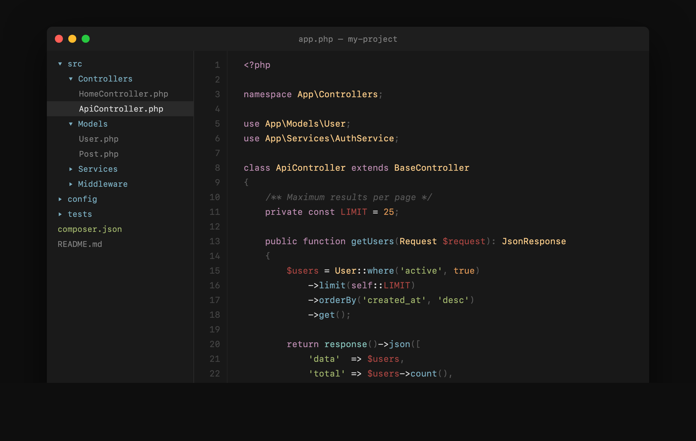

# Mercurial Color Scheme

[](https://github.com/renzojohnson/mercurial-color-scheme/blob/main/LICENSE)
[](https://packagecontrol.io/packages/Mercurial%20Color%20Scheme)
[](https://github.com/renzojohnson/mercurial-color-scheme/releases/latest)

A dark and light color scheme for Sublime Text based on Warp Terminal's default palette. Clean, balanced, and easy on the eyes for long coding sessions.

## Variants

| Variant | Background | Best For |
|---------|-----------|----------|
| **Mercurial** (dark) |  `#181818` | Low-light / night coding |
| **Mercurial Light** |  `#fafafa` | Bright environments / daylight |

## Preview

### Mercurial (Dark)



### PHP


### JavaScript


### CSS


### HTML


## Installation

### Package Control (Recommended)

1. Open Command Palette (`Cmd+Shift+P` / `Ctrl+Shift+P`)
2. Select **Package Control: Install Package**
3. Search for **Mercurial Color Scheme**
4. Activate:
   - Dark: **Preferences > Color Scheme > Mercurial**
   - Light: **Preferences > Color Scheme > Mercurial Light**

### Manual Installation

1. Download the desired scheme files
2. Place in `Packages/User/` (Preferences > Browse Packages)
3. Activate via **Preferences > Color Scheme**

### Sublime Text < Build 3149

Use the `.tmTheme` files. Add to your settings:

```json
"color_scheme": "Packages/Mercurial Color Scheme/Mercurial.tmTheme"
```

## Colors (Dark)

| Role | Color | Hex |
|------|-------|-----|
| Background |  | `#181818` |
| Foreground |  | `#d8d8d8` |
| Comments |  | `#585858` |
| Strings |  | `#a1b56c` |
| Keywords |  | `#ba8baf` |
| Functions |  | `#7cafc2` |
| Tags/Variables |  | `#ab4642` |
| Classes/Types |  | `#f7ca88` |
| Numbers |  | `#dc9656` |
| Library/Support |  | `#86c1b9` |

## Colors (Light)

| Role | Color | Hex |
|------|-------|-----|
| Background |  | `#fafafa` |
| Foreground |  | `#383838` |
| Comments |  | `#909090` |
| Strings |  | `#4d6820` |
| Keywords |  | `#8b4d80` |
| Functions |  | `#2a6f8e` |
| Tags/Variables |  | `#a03530` |
| Classes/Types |  | `#8a6d20` |
| Numbers |  | `#b06020` |
| Library/Support |  | `#247067` |

## Plugin Compatibility

Mercurial includes dedicated scopes for these popular Sublime Text plugins:

- **[GitGutter](https://packagecontrol.io/packages/GitGutter)** — colored gutter marks for insertions, deletions, and changes
- **[BracketHighlighter](https://packagecontrol.io/packages/BracketHighlighter)** — per-bracket-type coloring (curly, round, square, angle, tag, quote)
- **[SublimeLinter](https://packagecontrol.io/packages/SublimeLinter)** — error, warning, and info mark colors (SublimeLinter 4+)

## Supported Languages

Full syntax coverage for PHP, JavaScript, TypeScript, HTML, CSS, LESS, Sass/SCSS, JSON, YAML, Markdown, SQL, Python, Shell/Bash, CoffeeScript, Makefile, Twig, Handlebars, and all languages using standard TextMate scopes.

## Credits

- **Palette**: Based on [Warp Terminal](https://warp.dev) default dark theme
- **Author**: [Renzo Johnson](https://renzojohnson.com)
- **License**: MIT
